[Main GitHub](https://github.com/suryaprabhaz) · [Student GitHub](https://github.com/surya-scsvmv) · [Instagram](https://instagram.com/suryaprabhaz) · [Email](mailto:11249a284@kanchiuniv.ac.in)

---

### About

B.Tech student at **SCSVMV University** (2024–2028), studying **Computer Science and Engineering — Artificial Intelligence & Data Science**.

Interested in programming, algorithms, databases, AI, and interactive game development. I use GitHub to document my learning and build practical projects.

### Technologies

`C` · `C++` · `Java` · `Python` · `R` · `SQL` · `HTML` · `CSS` · `JavaScript` · `Git`

### Selected repositories

- [DSA](https://github.com/surya-scsvmv/DSA) — Data structures and algorithms in C
- [CPP](https://github.com/surya-scsvmv/CPP) — C++ programming practice
- [DAA](https://github.com/surya-scsvmv/DAA) — Design and analysis of algorithms
- [JAVA](https://github.com/surya-scsvmv/JAVA) — Java laboratory programs
- [DBMS](https://github.com/surya-scsvmv/DBMS) — Database management and SQL
- [R](https://github.com/surya-scsvmv/R) — R programming exercises

[View all repositories →](https://github.com/surya-scsvmv?tab=repositories)

---

LEARN · BUILD · IMPROVE

